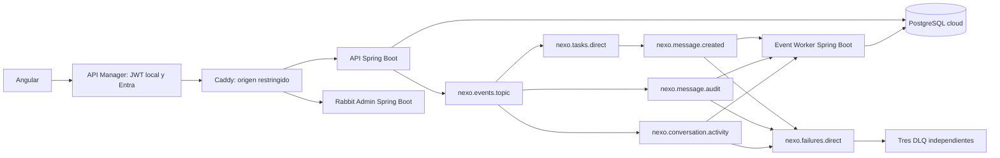

# Implementación EP3/EP4 de Nexo

Rama: `feature/rabbitmq-reliable-messaging-ep3-ep4`. Fecha: 14 de octubre de 2026.

## Arquitectura entregada

Tres aplicaciones Spring Boot independientes: `backend` (API de Nexo y outbox),
`event-worker` (proyecciones asíncronas), `rabbit-admin` (administración REST).
`event-support` es una biblioteca compartida, no un cuarto microservicio.
La base compartida es una decisión académica explícita; las migraciones las aplica
solo el backend antes de iniciar los workers. No se declara aislamiento completo
de datos por microservicio ni alta disponibilidad de la infraestructura.



## Correspondencia con la rúbrica

| Indicador | Implementación | Evidencia |
| --- | --- | --- |
| Centralización, 12% | `event-support/.../RabbitTopology.java` concentra colas, exchanges y routing keys. | Misma biblioteca en los tres servicios. |
| Beans, 13% | `Declarables`: seis colas, exchanges topic y direct, bindings entre exchanges y hacia colas/DLQ. | Pruebas de integración y topología consultable. |
| Separación, 10% | Configuración dedicada; productor publica sin declarar topología. | `MessageEventPublisher`, `RabbitTopology`. |
| Consumidores, 15% | Tres `@RabbitListener`, paquetes `notifications`, `audit`, `activity`. | Servicio `event-worker`. |
| ACK y errores, 20% | ACK manual después del commit; reintento transitorio limitado; reject/NACK sin requeue hacia DLQ. | Cinco pruebas de `ReliableConsumerTest` y prueba funcional con tres DLQ. |
| REST administrador, 13% | POST/DELETE de queues, exchanges, bindings; GET topology. | `RabbitAdminController`, pruebas HTTP y broker real. |
| Servicio administrador, 10% | `RabbitAdminService` encapsula operaciones AMQP. | Controlador no conoce detalles del broker. |
| Validaciones, 7% | DTO, nombres, tipos, TTL y routing keys; errores 400/409. | `AdminApiTest`. |

## Flujos funcionales

1. Avisos: crea notificaciones de mensajes para miembros autorizados de la conversación.
2. Auditoría: persiste identificador, conversación y tiempos, sin copiar el texto privado.
3. Actividad: proyección consultable en `GET /api/conversations/{id}/activity`, protegida por membresía.

Un envío escribe mensaje y outbox dentro de la misma transacción. Publicación y
consumo son procesos independientes. Publisher confirm y ACK del consumidor son
confirmaciones de etapas diferentes. La entrega es al menos una vez; las claves
primarias y `ON CONFLICT DO NOTHING` hacen idempotentes las proyecciones.

## API administradora

Base: `/api/admin/rabbit`.

| Método y ruta | Entrada |
| --- | --- |
| GET `/topology` | Estado de las seis colas y catálogo de exchanges. |
| POST `/queues` | `{"name":"nexo.demo.review","durable":true,"ttlMillis":60000}` |
| DELETE `/queues/{name}` | Solo colas de demostración vacías y sin consumidores. |
| POST `/exchanges` | `{"name":"nexo.demo.events","type":"TOPIC","durable":true}` |
| DELETE `/exchanges/{name}` | Nombre dentro del espacio de demostración. |
| POST `/bindings` | `{"queue":"nexo.demo.review","exchange":"nexo.demo.events","routingKey":"review.*"}` |
| DELETE `/bindings` | El mismo DTO identifica el binding. |

Se exige un JWT Entra válido para la audiencia de Nexo, scope `access_as_user` y
rol `ADMIN` o un object ID expresamente configurado en `NEXO_ADMIN_OBJECT_IDS`.
Por defecto no hay administradores en la allowlist. Un usuario local normal no
puede administrar RabbitMQ. Las operaciones dinámicas se limitan a `nexo.demo.*`;
no se permite destruir las colas de negocio del sistema.

## Ejecución y verificación

Java 21, Node 24 y Docker. Desde la raíz:

```powershell
.\mvnw.cmd --batch-mode --no-transfer-progress verify
cd frontend
npm ci
npm run test:ci
npm run build
cd ..
node --test infra/aws/authorizer.test.mjs
```

`compose.platform.yml` es la nueva plataforma. Perfil `local-db` incorpora
PostgreSQL local; en AWS se configura la URL JDBC de RDS y no se inicia ese perfil.
Perfil `web` incorpora Caddy y la SPA. Usar secretos propios en un archivo `.env`
ignorado; no utilizar las claves de pruebas en AWS.

```powershell
docker compose --env-file .env -f compose.platform.yml --profile local-db --profile web up -d --build
docker compose --env-file .env -f compose.platform.yml exec rabbitmq1 rabbitmqctl cluster_status
python scripts/verify-platform.py --allow-write --env-file .env
```

El verificador con `--allow-write` crea dos cuentas de prueba, envía un mensaje y
publica un evento inválido de demostración. Usarlo solo en un entorno de pruebas
identificado. Sin esa opción solo consulta health y comprueba rechazo de credenciales.
No imprime contraseñas ni JWT. Las tres DLQ reciben deliberadamente un mensaje.

## Compatibilidad y migraciones

V12 crea las proyecciones de auditoría y actividad. No modifica V11 ni otras
migraciones aplicadas. Las colas conservan nombres reconocibles, pero la nueva
topología utiliza un DLX explícito. Si se migra un broker antiguo con argumentos
de cola diferentes, no borrar ni purgar sus mensajes para resolver un error de
precondición: preparar un vhost nuevo o drenar y migrar de forma controlada.
El AWS Academy se encontró vacío antes de la reconstrucción; los recursos nuevos
y sus comprobaciones se registran en [la evidencia cloud](cloud-evidence.md).

El consumidor incrustado del backend se conserva para compatibilidad local.
La plataforma configura `NEXO_EVENTS_CONSUMER_ENABLED=false`; solo event-worker
consume en cloud. El frontend conserva su flujo y obtiene la configuración pública
de despliegue desde `runtime-config.js`, generado al iniciar el contenedor, sin
recompilar ni publicar secretos.

## Kafka y la guía EA3

`Guia_Teorica_EA3_Clase_I_Streaming_Kafka.pdf` es una guía conceptual sobre eventos,
topics, particiones, consumer groups, retención y Kafka Streams. No contiene una
rúbrica nueva ni una obligación de integrar Kafka en EP3/EP4. Estas evaluaciones
exigen RabbitMQ. LiveKit transmite medios y no constituye event streaming Kafka.

La decisión actual es completar la mensajería evaluada y conservar una frontera
de eventos desde la que se pueda incorporar Kafka cuando exista el encargo EA3.
Una ampliación justificada sería publicar eventos sin contenido privado de
`message.created` hacia un topic con clave de conversación, con grupos separados
de auditoría/analítica, retención y métricas por ventanas. No se presenta esa
ampliación como implementada ni como un criterio satisfecho de una pauta no recibida.

## Estado de validación

Comprobado localmente: 46 pruebas backend, 5 de procesamiento fiable, 4 del
administrador (incluida integración RabbitMQ real), 89 frontend y 2 de seguridad
del autorizador. Build Angular y formato correctos. Dos nodos RabbitMQ en el
mismo clúster, tres consumidores, tres proyecciones y tres DLQ comprobados.

La recreación cloud se realiza mediante `infra/aws/deploy.py`. EC2 y RDS ya están
creados; consultar [la evidencia cloud](cloud-evidence.md) para distinguir los
resultados verificados de las pruebas públicas que todavía estén pendientes.
