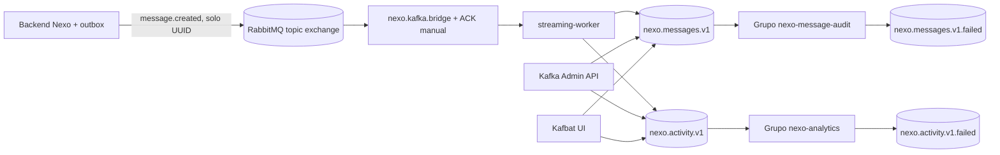

# Implementación Kafka para EP5/EP6

Esta documentación contrasta la implementación con los encargos EP5 y EP6
adjuntos. No sustituye la pauta del docente ni afirma una nota garantizada.
Los PDFs piden que Kafka complemente a RabbitMQ: no que lo reemplace.

## Resumen de la solución



El backend confirma la transacción SQL y publica por outbox en RabbitMQ. Un
consumidor de puente traduce el evento a un DTO pequeño y lo publica en Kafka.
El ACK Rabbit llega después de que se confirman los dos envíos Kafka; si algo
falla, el evento vuelve a la DLQ Rabbit configurada. La semántica entre ambos
sistemas es **al menos una vez**, por lo que puede haber duplicados y los
consumidores deben ser idempotentes. El UUID del evento se usa como clave Kafka.

El payload lleva `eventId`, `eventType`, `routingKey`, `occurredAt` y `source`.
No replica el cuerpo del chat, correo, nombre ni token. El segundo topic publica
una proyección de actividad derivada y no el contenido del mensaje. Logs de
consumidores registran topic, partición, offset, tipo de proyección y UUID; no
datos de cuenta ni texto privado.

## Qué se añadió al código

| Criterio de EP5 | Código/evidencia | Alcance |
| --- | --- | --- |
| Cliente Kafka, conexión, serializadores y grupos (12%) | `streaming-worker/src/main/resources/application.yml` | Bootstrap servers, productor `acks=all`, idempotencia, retries, consumidor sin auto-commit y grupos por proyección. |
| Productores y consumidores en dos topics (12%) | `KafkaStreamPublisher`, `KafkaEventConsumers` | Dos topics, DTO validado y claves estables; consumidores separados por `@KafkaListener`. |
| Microservicio administrador Kafka (6%) | módulo `kafka-admin` | Lista topics/grupos, offsets/lag; crea, actualiza configuración y elimina solo `nexo.demo.*`. |
| Productor (14%) / consumidor (14%) | `streaming-worker` | El productor transforma el evento Rabbit; cada grupo procesa su topic y reporta metadata operativa. |
| Errores (12%) | `RabbitKafkaBridge`, `KafkaConsumerErrorConfiguration` | UUID inválido a DLQ Rabbit; errores transitorios de Kafka reintentan dos veces y luego se publican en topic `.failed`. |
| Particiones, réplicas y retención (12%) | `infra/kafka-ep5/compose.yml` | Dos topics con 3 particiones, RF=3, min ISR=2 y retención de 7 días; los `.failed` tienen retención de 14 días. |
| Consumer groups (12%) | `KafkaEventConsumers` | `nexo-message-audit` y `nexo-analytics`, asignación paralela por partición. |
| Administración repetible (6%) | API Kafka Admin + Compose | API autenticada para cambios de demo y herramientas reproducibles de Compose/Kafka UI. |

| Criterio de presentación EP6 | Prueba preparada | Qué decir/mostrar |
| --- | --- | --- |
| 3 nodos ZooKeeper + 3 brokers (10%) | Compose levanta `zk1..zk3` y `kafka1..kafka3`. | Explicar quórum ZooKeeper (mayoría 2/3) y que son contenedores distintos pero comparten un host. Es un laboratorio, no tolera la caída del host. |
| Dos topics, 3 particiones y 3 réplicas (10%) | Inicializador crea `nexo.messages.v1` y `nexo.activity.v1`; dos topics `.failed` son auxiliares. | Mostrar particiones y replicación en Kafbat UI; RF=3 no significa tres copias independientes si todos los brokers están en la misma máquina. |
| Kafka UI (5%) | Kafbat UI en `http://localhost:18090`. | Brokers, topics, distribución, mensajes y consumer groups. |
| Flujo productor-consumidor (12%) | Nexo → outbox → Rabbit → puente → Kafka → dos grupos. | Enviar un mensaje de prueba y seguir el UUID/metadata, sin revelar texto sensible. |
| Esquema del evento (6%) | `NexoStreamEvent`. | Justificar cada campo y minimización de datos. |
| Reactividad (12%) | El evento aparece tras un mensaje nuevo. | Contrastar hora de envío, offset y lectura; usar polling de UI como visualización, el transporte es asíncrono. |
| Conceptos y decisiones (15%) | Topics con 3 particiones, RF=3, ISR=2, retención; grupos independientes. | Partición paraleliza; réplica tolera falla de broker; ISR define réplicas sincronizadas; grupo reparte una partición entre un consumidor del grupo. |
| Offset, lag y distribución (15%) | Kafbat UI y endpoints `/consumer-groups/{id}/lag`. | El lag es `offset final - offset confirmado`, por partición y total. Distribución visible por asignación. |
| Casos de uso/configuración (15%) | Topic messages para auditoría técnica y activity para analítica agregada. | Retención por tipo de dato y consumidor; no tratar logs como archivo de chat. |

Los porcentajes y criterios se transcriben de los encargos adjuntos; su suma es
100% por evaluación. Las indicaciones entregables de EP5 exigen Docker Compose
con RabbitMQ, ZooKeeper, brokers y Kafka UI además de los servicios Spring/Angular.

## Levantar el laboratorio local

Requisitos: Docker Compose, aproximadamente 6–8 GiB disponibles para contenedores,
Java 21 y Node 24 para compilar localmente. Este Compose se limita a loopback: no
expone Kafka ni APIs de administración a Internet.

1. Desde la raíz, crea `.env` a partir de `.env.example` y completa los secretos
   exigidos por la plataforma (no guardes el archivo en Git).
2. Levanta PostgreSQL local, RabbitMQ y los servicios base; o usa el backend cloud
   que ya tengas accesible:

   ```powershell
   docker compose --env-file .env -f compose.platform.yml --profile local-db up -d --build
   ```

3. Levanta el clúster académico en otra terminal:

   ```powershell
   docker compose --env-file .env -f infra/kafka-ep5/compose.yml up -d --build
   docker compose --env-file .env -f infra/kafka-ep5/compose.yml ps
   ```

   La red `nexo-platform_default` debe existir, por lo que primero se inicia la
   plataforma. Si solo se quiere revisar el clúster sin tráfico de Nexo, se puede
   iniciar Compose base con los servicios Rabbit necesarios.

4. Revisa `http://localhost:18090` (Kafbat UI). Broker addresses: `localhost:9092`,
   `localhost:9094`, `localhost:9096`. Kafka Admin health: `localhost:18083/actuator/health`;
   Streaming Worker health: `localhost:18084/actuator/health`.
5. Crea un mensaje nuevo en Nexo. En Kafbat comprueba `nexo.messages.v1`,
   `nexo.activity.v1`, offsets y grupos; el backlog Rabbit debería volver a cero
   al procesarse el evento, por lo que la tasa/contador y los offsets prueban mejor
   el flujo que esperar una cola siempre llena.

Para inspección rápida en terminal:

```powershell
docker compose -f infra/kafka-ep5/compose.yml exec kafka1 kafka-topics --bootstrap-server kafka1:29092 --describe --topic nexo.messages.v1
docker compose -f infra/kafka-ep5/compose.yml exec kafka1 kafka-consumer-groups --bootstrap-server kafka1:29092 --describe --group nexo-message-audit
docker compose -f infra/kafka-ep5/compose.yml logs --since 5m streaming-worker
```

El API Admin requiere token Entra con scope `access_as_user` y `ADMIN` o un `oid`
en `NEXO_ADMIN_OBJECT_IDS`. En esta demo no muta los topics de negocio, solo los
que comienzan con `nexo.demo.`. Rutas principales: `GET /api/admin/kafka/topics`,
`POST /topics`, `PUT /topics/{name}/config`, `DELETE /topics/{name}`,
`GET /consumer-groups`, `GET /consumer-groups/{id}/lag`.

## Estado, límites y decisiones de despliegue

El clúster desplegado anteriormente en AWS Academy está descrito como Kafka 4 en
modo KRaft con **un broker** y un topic con RF=1. El nuevo Compose de evaluación
es otro entorno; todavía no se despliega en AWS. No afirmes que el broker de AWS
cumple RF=3 ni que presenta alta disponibilidad. Para probar tres brokers de
forma fiel en la nube se requieren recursos separados, costos/créditos y un plan
de despliegue propio; no se ha modificado AWS en esta rama.

Kafka 4 eliminó el modo ZooKeeper y requiere KRaft. Este Compose fija Confluent
Platform 7.9 para el ejercicio explícito de ZooKeeper que solicita EP5/EP6; no es
la línea recomendada para un nuevo sistema de producción.

El Compose actual de EP5/EP6 no integra por sí solo el Grafana del stack AWS. La
rúbrica EP5/EP6 pide supervisar offsets/lag/distribución en Kafka UI o CLI; Grafana
es una vista complementaria ya documentada aparte. No inventes métricas de este
laboratorio en el dashboard AWS.

### Bloqueos concretos antes del despliegue en AWS Academy

- La vista EC2 del 12-11-2026 muestra la instancia de aplicación `t3.medium` y la
  instancia de observabilidad `t3.large` activas. No se consultaron cuotas, RAM,
  almacenamiento libre ni estado de contenedores en esa sesión.
- El Compose académico usa la red Docker `nexo-platform_default` y los nombres
  internos `rabbitmq1`/`rabbitmq2`. Docker no comparte redes entre las dos EC2;
  subir el archivo tal cual a `nexo-observability` dejaría el worker sin acceso a
  RabbitMQ y podría competir por memoria con Grafana/Prometheus.
- Antes de migrar hay que crear un SG dedicado para Kafka y permitir sus listeners
  solo desde los SG de aplicación y observabilidad. Para que el worker remoto
  alcance RabbitMQ, publicar AMQP únicamente en la interfaz privada de la EC2 de
  aplicación y permitir TCP 5672 solo desde el SG Kafka. No abrir esos listeners
  a `0.0.0.0/0`; ZooKeeper (2181/2888/3888) debe permanecer solo en el SG Kafka.
- Mantener el clúster Kafka nuevo en un host separado con capacidad suficiente;
  comprobar cuotas de AWS Academy, créditos y RAM antes de crear la instancia. No
  reiniciar ni sustituir el Kafka vigente hasta probar productor, topics,
  replicación, consumidores, Kafbat y Prometheus con el clúster nuevo.
- Reconfigurar Kafbat y Kafka Exporter del host de observabilidad para usar los
  listeners privados nuevos, y actualizar el bootstrap server de productores.
  La URI pública de Kafbat debe seguir detrás de Caddy y Basic Auth; los puertos
  de brokers continúan privados.

Hasta completar estos pasos, el estado honesto es: **código y Compose preparados;
topología EP5/EP6 de tres brokers aún no desplegada en AWS**. Las instancias
visibles en EC2 no son suficientes para declarar probado el flujo.

En la revisión del 12-11-2026, AWS EC2 mostró ambas instancias activas, pero
Systems Manager Run Command no listó nodos administrados. No se intentó modificar
sus perfiles IAM ni abrir accesos remotos; el despliegue queda bloqueado hasta
resolver la administración SSM y volver a medir capacidad/cuotas.

## Validación

Se agregaron pruebas unitarias para la proyección del evento y para el puente,
y pruebas HTTP para permisos y administración de topics. Deben ejecutarse con
Java 21 en CI o en un host con Java instalado. La rama de trabajo se encuentra
aislada como `feature/ep6-nexo-remodel`; los recursos AWS no se cambiaron.
